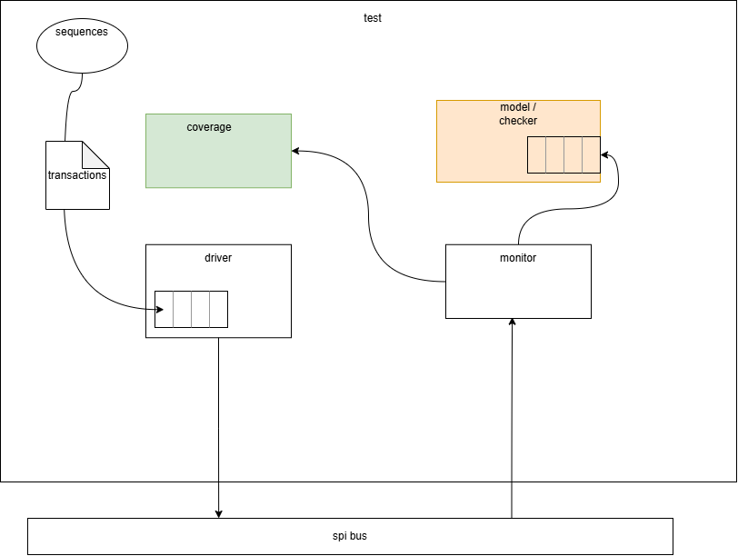

# Cocotb-Based SPI Slave and Single-Port RAM Verification

This project contains a Verilog SPI slave connected to a 256-byte, single-port
RAM, together with a Cocotb testbench, a functional coverage model, and a
multi-seed regression runner. The testbench drives SPI transactions, monitors
the serial interface, predicts RAM behavior with a software reference model,
and checks data returned by the DUT.

The detailed RTL specification, design description, and verification
requirements are in
[SPI Slave + Single-Port RAM - RTL Specification](<spec_doc/SPI Slave + Single-Port RAM – RTL Specification.pdf>).

## Testbench architecture



The Cocotb master driver serializes transactions on MOSI and generates SCLK.
The monitor independently reconstructs transactions from the DUT pins. Complete
transactions are passed to the reference model, which tracks the expected
write and read addresses and the contents of a 256-byte software RAM. For read
transactions, the model compares the expected byte against the byte sampled
from MISO. Functional coverage is sampled from the monitored transaction
stream.

The synthesizable DUT hierarchy is `spi_wrapper`, which connects `spi_slave`
and `spi_ram`. The slave synchronizes the SPI signals into the system clock
domain; the design requires the system clock to be at least eight times faster
than SCLK. Refer to requirement TOP-003 in the specification for the timing
requirement and its rationale.

## SPI protocol and DUT behavior

The implementation uses SPI mode 0 (CPOL=0, CPHA=0), transmits command and
input bytes MSB first, and uses an active-low chip select (`ss_n`). A selected
input frame contains a two-bit command followed by one byte:

| Command | Name | Input byte meaning | RAM/slave operation |
| --- | --- | --- | --- |
| `00` | `WRITE_ADDR` | Address | Load the write-address register |
| `01` | `WRITE_DATA` | Data | Write the byte at the current write address |
| `10` | `READ_ADDR` | Address | Load the read-address register |
| `11` | `READ_DATA` | Dummy byte | Return the addressed RAM byte on MISO |

The RAM has 256 byte locations, is initialized to zero for simulation, and has
independent write- and read-address registers. It responds to completed frames
indicated by `rx_valid`. On `READ_DATA`, the slave waits for the RAM response
and shifts the returned byte out on MISO. Deasserting `ss_n` ends the frame and
returns the SPI interface to its idle behavior. Reset is active low.

## Testbench features

The testbench is implemented in [testbench/test_spi.py](testbench/test_spi.py).
Its principal components are:

- **Clock and SPI master driver:** Generates a 10 ns system clock and an SCLK
  with a 100 ns period (one tenth of the system-clock frequency). Drives
  command/data bytes MSB first, controls `ss_n`, and inserts 500 ns of bus-free
  time between transactions.
- **Transaction generation:** Represents a transaction with a command, byte,
  abort flag, and extended-frame flag. Random transactions select all four
  commands, a byte value, an abort choice, and whether to add extra SCLK
  activity.
- **Abort and extended-frame stimulus:** Can raise `ss_n` during a frame at
  randomized bit positions. For `READ_DATA`, the abort position is selected
  later in the read sequence. Extended transactions add five further SCLK
  falling edges before the bus returns idle.
- **Independent monitor:** Samples command and payload bits from the DUT pins.
  It recognizes the dummy MOSI byte for reads and samples the response on
  MISO. Aborted frames are marked and discarded instead of being sent to the
  reference model.
- **Reference model and scoreboard:** Maintains a software RAM image plus
  separate read and write addresses. Completed write-address and read-address
  commands update the corresponding pointer; write-data updates the modeled
  memory; read-data asserts that the received MISO byte matches the modeled
  byte.
- **Reset checks:** Applies an active-low reset and checks that MISO is low
  during reset. One test asserts reset during bus activity, clears the model's
  address state, discards queued stimulus, and then performs a follow-up read.
- **Functional coverage:** Samples command, address, abort/completion,
  command-transition, address-by-address-command, and command-by-abort
  combinations. Aborted transactions are excluded from the command-transition
  history.

### Cocotb tests

| Test | Stimulus and checks |
| --- | --- |
| `test_random` | Sends 1,000 randomized transactions, covering all command types, random data/addresses, abort choices, and optional extended frames. Completed reads are checked against the reference RAM. |
| `test_write_read_random_abort` | Iterates over all 256 addresses. For each address, queues a write-address, write-data, read-address, and read-data sequence. The data pattern is `(address * 37 + 0xA5) & 0xFF`; each frame independently receives a randomized abort choice. Completed reads are checked by the model. |
| `test_extended` | Sends 100 randomized, non-aborted transactions with five extra SCLK falling edges per frame. |
| `test_reset_ongoing` | Starts read transactions, injects reset while the bus is active, resets the model's address state, clears the remaining queued transactions, then queues a follow-up read. |
| `report` | Exports the accumulated Cocotb functional coverage database to the path in `SPI_COVERAGE_FILE`, or `coverage.yaml` by default. |

## Reported bug

The SPI slave incorrectly used a shared address register for both read and
write address commands, without keeping their address state separate. As a
result, a successfully received write address could become the address used by
a later read. For example, if a read-address frame was aborted, a subsequent
read-data command could read from the last successfully received write address
instead of the last successfully received read address. Read and write
addresses must be tracked independently, and an aborted address frame must
not change the corresponding saved address.

## Functional coverage

The coverage model in `testbench/test_spi.py` defines the following coverage
points and crosses:

| Coverage item | Bins | Meaning |
| --- | ---: | --- |
| `spi.command` | 4 | Each of the four SPI commands |
| `spi.addr` | 256 | Every 8-bit address, sampled for address commands |
| `spi.abort` | 2 | Aborted and completed transactions |
| `spi.cmd_transitions` | 16 | Every previous/current command pair |
| `spi.addr_cmd_cross` | 512 | Every address crossed with each address command (`WRITE_ADDR`, `READ_ADDR`) |
| `spi.cmd_abort_cross` | 8 | Every command crossed with both abort outcomes |
| **Total** | **798** | Aggregate bins in the current coverage model |

The checked-in regression artifacts report **798/798 bins covered (100%)** in
the merged report at
`sim/regression_runs/coverage_merged.yaml`. This is the result recorded by
the existing regression run; rerun the regression to produce fresh reports
for a new checkout or after making changes.

## Running the simulation and regression

The simulation setup in [sim/Makefile](sim/Makefile) uses Questa/ModelSim,
Cocotb, and GNU Make. It compiles the Verilog sources from `rtl/` and loads
`testbench/test_spi.py` as the Cocotb test module. Ensure `make`,
`cocotb-config`, Python with `cocotb` and `cocotb-coverage`, and the Questa
simulator are installed and available in the environment.

Run one simulator invocation from the `sim` directory:

```powershell
cd sim
make GUI=0 WAVES=0
```

The regression runner executes five simulator invocations using distinct
seeds, writes per-seed Cocotb XML results, coverage YAML, and simulator logs,
then merges the coverage reports:

```powershell
cd sim
python run_regression.py
```

The default seeds are `104729`, `130363`, `155921`, `181081`, and `205759`.
Exactly five distinct seeds are required. To use a different set:

```powershell
python run_regression.py --seeds 11 22 33 44 55
```

By default, outputs are written under `sim/regression_runs/`:

- `seed_<seed>/results.xml` - Cocotb test results for that seed.
- `seed_<seed>/coverage.yaml` - Functional coverage for that seed.
- `seed_<seed>/simulator.log` - Complete simulator and Make output.
- `regression_summary.json` - Parsed test counts and simulator exit status.
- `coverage_merged.yaml` - Coverage merged across the five seeds.

`sim/regression_runs/` is ignored by Git because these are generated run
artifacts.

### Recorded regression status

The checked-in report snapshot contains five Cocotb tests for each of the five
seeds: **25 test executions total, with zero reported failures or errors**.
The merged functional coverage is **100% (798/798 bins)**.

## Project layout

```text
.
|-- rtl/
|   |-- spi_slave.v       SPI slave protocol engine
|   |-- spi_ram.v         Single-port RAM and command handling
|   `-- spi_wrapper.v     Top-level RTL connections
|-- sim/
|   |-- Makefile          Questa/Cocotb simulation setup
|   |-- coverage.yaml     Functional coverage configuration
|   `-- run_regression.py Five-seed runner and coverage merger
|-- spec_doc/
|   |-- SPI Slave + Single-Port RAM - RTL Specification.pdf
|   |-- testbench_arch.png
|   `-- bug               Captured bug note
|-- testbench/
|   `-- test_spi.py       Driver, monitor, model, tests, and coverage
`-- README.md
```
